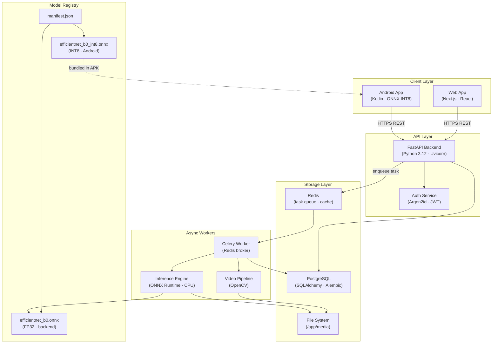
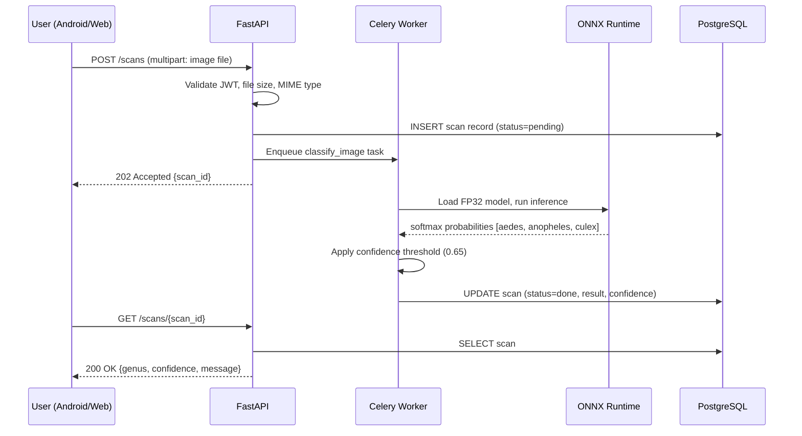
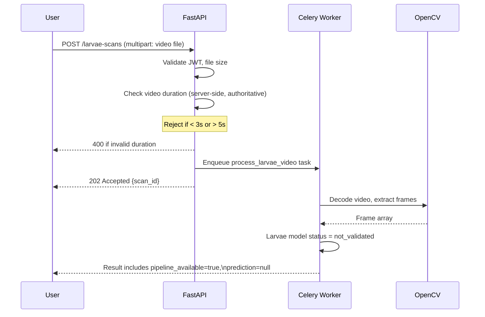

# Vectora AI — System Architecture

> [!NOTE]
> Vectora AI is a multi-platform mosquito identification system. Field researchers photograph or video adult mosquitoes; the system returns a genus-level identification (Aedes, Anopheles, or Culex) with a confidence score.

---

## High-Level Component Overview

---

## Data Flow — Image Classification

---

## Data Flow — Video Larvae Pipeline

---

## Technology Stack

| Layer | Technology | Version | Notes |
|-------|-----------|---------|-------|
| **Android client** | Kotlin | — | ONNX Runtime Android |
| **Android ML** | ONNX Runtime | — | INT8 quantized model bundled in APK |
| **Web client** | Next.js / React | — | Node 26, npm 11 |
| **API framework** | FastAPI | 0.115.5 | Async, OpenAPI auto-docs |
| **ASGI server** | Uvicorn | 0.32.1 | Multi-worker in production |
| **ML runtime** | ONNX Runtime | 1.20.1 | CPU-only (no CUDA) |
| **Task queue** | Celery | 5.4.0 | Redis broker |
| **Message broker / cache** | Redis | 5.2.1 | — |
| **Database** | PostgreSQL | — | SQLAlchemy 2 ORM |
| **Migrations** | Alembic | 1.14.0 | — |
| **Password hashing** | Argon2id | — | passlib + argon2-cffi |
| **Auth tokens** | JWT (HS256) | — | python-jose |
| **Video decoding** | OpenCV | 4.10.0.84 | Headless build |
| **Image processing** | Pillow | 11.0.0 | — |
| **Containerisation** | Docker + Compose | — | Multi-stage Dockerfile |

---

## Module Responsibilities

### `backend/app/api/`
Defines all HTTP route handlers (FastAPI routers). Responsible for:
- Request validation and authentication checks
- Dispatching Celery tasks for async processing
- Returning HTTP responses; no business logic

### `backend/app/core/`
Cross-cutting concerns:
- JWT creation and validation
- Configuration loading (`pydantic-settings`)
- Security utilities (password hashing, cookie helpers)

### `backend/app/db/`
Database layer:
- SQLAlchemy model definitions
- Alembic migration environment
- Session factory and dependency injection

### `backend/app/inference/`
ML inference module:
- Loads and caches the ONNX FP32 model
- Implements image pre-processing pipeline (resize → RGB → normalize)
- Applies confidence threshold and uncertainty messaging

### `backend/app/schemas/`
Pydantic request/response schemas for all API endpoints.

### `backend/app/services/`
Business logic layer (called by route handlers and workers):
- Scan lifecycle management
- File upload handling
- Video duration validation

### `backend/app/workers/`
Celery task definitions:
- `classify_image` — runs ONNX inference and writes result to DB
- `process_larvae_video` — video frame extraction pipeline
