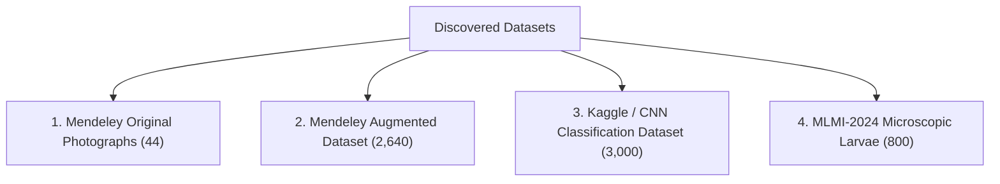

# Vectora AI — Dataset Discovery and Audit Report

**Date:** 2026-11-11  
**Auditor:** Senior Computer Vision & Data Quality Engineer (Antigravity)  

---

## 1. Discovered Datasets Overview

We discovered 4 distinct mosquito datasets across `/home/nimr/Projects/mosqscan` and `/home/nimr/Downloads`:



| # | Dataset Identifier | Location | Total Files | Verified Species / Classes | Primary Role |
|---|---|---|---|---|---|
| **1** | **Mendeley Data v4 Original Photographs** | `/home/nimr/Projects/mosqscan/Mosquito Images Original.zip` | 44 images | *Aedes aegypti* (15)<br>*Anopheles stephensi* (9)<br>*Culex quinquefasciatus* (20) | **Primary Benchmark Ground Truth** |
| **2** | **Mendeley Data v4 Augmented Images** | `/home/nimr/Projects/mosqscan/Mosquito Images Augmented.zip` | 2,640 images | *Aedes* (900)<br>*Anopheles* (540)<br>*Culex* (1,200) | **Synthetic Stress-Testing** |
| **3** | **CNN Mosquito Classification Dataset** | `/home/nimr/Downloads/mosquito-dataset-for-classification-cnn.zip` | 3,000 images | *Aedes* (1,000)<br>*Anopheles* (1,000)<br>*Culex* (1,000) | **Audited — High Synthetic Duplication** |
| **4** | **MLMI-2024 (Larvae Microscopic Images)** | `/home/nimr/Downloads/MLMI-2024 (Mosquito Larvae Microscopic Images).zip` | 800 images | *Aedes aegypti* (400)<br>*Culex quinquefasciatus* (400) | **Larval Anatomy Baseline (Microscopic)** |

---

## 2. In-Depth Audit of Each Dataset

### Dataset 1: Mendeley Original Photographs (Reshma Pise et al., 2022)
* **Citation & Provenance:** Mendeley Data, Version 4, DOI: `10.17632/88s6fvgg2p.4`. Licensed under CC BY 4.0. Confirmed by professional entomologists.
* **Capture Device & Setup:** OnePlus phone camera (48 Megapixels). Pinned adult mosquitoes placed against clean white cards.
* **Resolution Distribution:** Ultra-high resolution: 4000x3000 to 8000x6000 pixels (2.1 MB – 3.8 MB JPEG each).
* **Specimen Condition:** **Freshly collected adults** (freshly sacrificed laboratory/field catches). Not damaged or desiccated dead field mosquitoes.
* **Duplicates & Corruptions:** 0 corrupted files. **0 duplicates** (44 unique MD5 hashes).
* **Suitability for Training:** **HIGH for validation/testing, POOR as sole training set** due to extreme scarcity (only 44 total specimens).

### Dataset 2: Mendeley Augmented Dataset
* **Composition:**
  * `Aedes Aegypti`: 900 images (derived from 15 originals × 60 augmentations)
  * `Anopheles Stephensi`: 540 images (derived from 9 originals × 60 augmentations)
  * `Culex Quinquefasciatus`: 1,200 images (derived from 20 originals × 60 augmentations)
* **Transformations Applied:** Offline affine rotations, shear, zoom, brightness shifts.
* **CRITICAL DATA LEAKAGE RISK:**
  * Files are named sequentially (`Aedes_aegypti_1.jpg` to `900.jpg`).
  * The filenames **do not encode which original specimen generated each image**.
  * **Warning:** Randomly splitting this folder into train/val/test guarantees data leakage, where augmented versions of test specimens appear in training, producing artificially inflated F1 scores.

### Dataset 3: CNN Mosquito Classification Dataset (Downloads)
* **Audit Findings:**
  * Total files: 3,000 (1,000 per genus).
  * **MD5 Duplicate Analysis:**
    * `AEDES`: 1,000 images → **402 unique**, **598 exact byte duplicates**.
    * `ANOPHELES`: 1,000 images → **639 unique**, **361 exact byte duplicates**.
    * `CULEX`: 1,000 images → **40 unique**, **960 exact byte duplicates (96% duplicate!)**.
  * **Suitability:** **UNSUITABLE for unbiased scientific benchmarking** without deduplication. Training on this dataset with naive splitting leaks identical duplicates across splits.

### Dataset 4: MLMI-2024 Microscopic Larvae Dataset (Downloads)
* **Composition:** 800 microscopic photographs (CC BY 4.0).
  * *Aedes aegypti* (400 images): abdomen (100), full body (100), head (100), siphon (100).
  * *Culex quinquefasciatus* (400 images): abdomen (100), full body (100), head (100), siphon (100).
* **Specimen Condition:** Microscope slide preparations of larvae under transmitted illumination.
* **Important Scientific Caveat:**
  * This dataset contains **microscopic slide images**, NOT live larvae swimming in water recorded by a smartphone camera.
  * *Anopheles* larvae are completely missing.
  * It can be used for anatomical feature validation (e.g. siphon presence/absence), but cannot validate the PRD's live kinematic video tracking pipeline.

---

## 3. Class Mapping & Scientific Taxonomy

| Source Label | Genus Mapping | Life Stage | Clinical / Vector Importance |
|---|---|---|---|
| `Aedes aegypti` | **`Aedes`** | Adult | Vector of Dengue, Chikungunya, Zika, Yellow Fever |
| `Anopheles stephensi` | **`Anopheles`** | Adult | Urban vector of Malaria (*Plasmodium vivax*, *P. falciparum*) |
| `Culex quinquefasciatus`| **`Culex`** | Adult | Vector of Lymphatic Filariasis, West Nile Virus |
| `Non-Mosquito / Lookalike`| **`Negative (Rejection)`** | Various | Spiders, craneflies, midges, bees, ants |

> [!CAUTION]
> **Scientific Integrity Rule:**
> Visual classification identifies genus and candidate species tendencies (e.g., whether a species is known to bite humans). A photograph **cannot determine whether an individual mosquito carries a pathogen or has fed on human blood**. Individual blood-meal confirmation requires molecular DNA testing (PCR/cyt-b).

---

## 4. Specimen-Level Train/Validation/Test Split Policy

To eliminate data leakage, the active split (`data/splits.csv`) enforces strict **group-disjoint isolation** using `specimen_id`:

```text
Genus         Train (Specimens)    Validation (Specimens)    Test (Specimens)    Total
Aedes                11                       2                     2              15
Anopheles             7                       1                     1               9
Culex                14                       3                     3              20
Total                32                       6                     6              44
```

* **Guarantee:** No physical specimen present in `train` appears in `validation` or `test`.
* **Exploratory Constraint:** Because test set size is small ($N=6$), individual test errors have high percentage weight ($16.7\%$ per sample). Metrics serve as a pipeline smoke test rather than statistical proof of clinical readiness.
