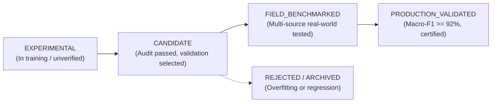
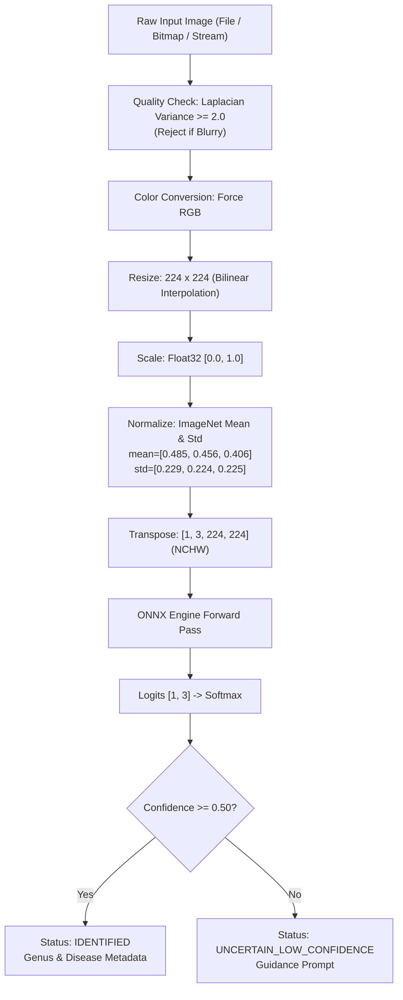

# Vectora AI — Model Registry & Specification

**Document Version:** 1.0.0  
**Status:** Active Registry  
**Last Updated:** November 11, 2026  
**Registry Configuration:** [`configs/model_manifest.json`](file:///home/nimr/Projects/mosqscan/vectora-ai-starter/configs/model_manifest.json)

---

## 1. Registry Architecture & Versioning Policy

The Vectora AI Model Registry governs model artifacts throughout their experimental lifecycle, providing reproducible lineage from raw weights to mobile-quantized edge deployment.

### 1.1 Lifecycle State Model

- **`EXPERIMENTAL`**: Intermediate training checkpoints and parameter explorations.
- **`CANDIDATE`**: Provisionally selected based strictly on validation split performance. Qualified for edge runtime integration testing, latency profiling, and CameraX pipeline binding.
- **`FIELD_BENCHMARKED`**: Tested across independent external datasets (multi-sensor, geographic variability, diverse light and background conditions).
- **`PRODUCTION_VALIDATED`**: Strictly reserved for models achieving $\ge 92.0\%$ Macro-F1 across independent external field validation sets, meeting PRD acceptance criteria.

---

## 2. Active Provisional Candidate Specification

### 2.1 Model Identity & Governance
- **Candidate Model ID:** `vectora-efficientnet-b0-exp-b`
- **Release Version:** `0.2.0-exp-b`
- **Evaluation & Release Status:** `EXPERIMENTAL_NOT_FIELD_VALIDATED`
- **Lifecycle Stage:** `provisional_research_candidate`
- **Production Validated:** `False`
- **Selection Basis:** Top validation Macro-F1 (0.6190) achieved with parsimonious parameter footprint (1,133,235 trainable parameters; 28.25% of backbone).

> [!WARNING]
> **FIELD DEPLOYMENT PROHIBITION**  
> `vectora-efficientnet-b0-exp-b` is an experimental research candidate trained on 44 original Indian mosquito specimens (Mendeley Data v4). It has not been validated for autonomous epidemiological vector decision-making.

---

### 2.2 Model Architecture & Parameter Footprint

- **Base Architecture:** `EfficientNet-B0` (torchvision implementation)
- **Input Channels:** 3 (RGB)
- **Output Classes:** 3 (`aedes`, `anopheles`, `culex`)
- **Total Parameters:** 4,011,391
- **Trainable Parameters:** 1,133,235 (28.25%)
- **Frozen Parameters:** 2,878,156 (71.75%)
- **Trainable Submodules:**
  - `features.7` (MBConv stage 7)
  - `features.8` (Conv head stage 8: 1x1 Conv2d, BatchNorm2d, SiLU)
  - `classifier.1` (Linear classification head: 1280 $\to$ 3)
- **Frozen Submodules:**
  - `features.0` through `features.6` (MBConv stages 1 to 6)

---

### 2.3 Artifacts & Cryptographic Checksums

All artifacts are persisted in the repository under version control or local model storage:

| Target Platform | Artifact Relative Path | Format | Size | SHA-256 Checksum |
| :--- | :--- | :--- | :--- | :--- |
| **PyTorch Training** | `experiments/exp_B_unfreeze_stage7_8_best.pt` | PyTorch State Dict | 16,347,189 B | `7b7f122cc275ba9daeb6d13c80156353054dadd22960b60c82a96bee6e00fe5f` |
| **Cloud / Web Inference** | `models/vectora_candidate_exp_b.onnx` | ONNX Opset 18 (FP32) | 16,035,577 B | `d644b9cd9c952d461bbfbb44e8b1926cdcf9bbbfb9cd43f85065cbed0d7b1499` |
| **Android CameraX / Edge** | `models/vectora_candidate_exp_b_int8.onnx` | ONNX Dynamic INT8 | 4,362,942 B | `6d7e830699f4ca3f3b67c538c2f77a592f88288845dfa00d94c7837ccef68803` |

---

### 2.4 Tensor & Preprocessing Contract

Both Android (Kotlin/C++) and Web (Python/TypeScript) platforms must strictly adhere to this exact tensor contract:

#### Tensor Specification
- **Input Name:** `input`
- **Input Shape:** `[1, 3, 224, 224]` (Batch=1, Channels=3, Height=224, Width=224)
- **Data Type:** `Float32`
- **Output Name:** `logits`
- **Output Shape:** `[1, 3]`
- **Data Type:** `Float32`

#### Fixed Class Ordering & Mapping
The model output indices map strictly to alphabetical genus order:

| Class Index | Genus Name | Common Public Health Representatives | Known Vector Pathogens |
| :---: | :--- | :--- | :--- |
| **0** | `aedes` | *Aedes aegypti*, *Aedes albopictus* | Dengue, Chikungunya, Zika, Yellow Fever |
| **1** | `anopheles` | *Anopheles stephensi*, *Anopheles culicifacies* | Malaria (*Plasmodium vivax*, *P. falciparum*) |
| **2** | `culex` | *Culex quinquefasciatus*, *Culex pipiens* | Lymphatic Filariasis, West Nile Virus, Japanese Encephalitis |

#### Output Interpretation & Quality Guards
- **Probability Transformation:** $\hat{p}_i = \frac{e^{z_i - \max(z)}}{\sum_j e^{z_j - \max(z)}}$
- **Confidence Acceptance Threshold:** $\max(\hat{p}) \ge 0.50$.
- **Sharpness Guard:** Grayscale Laplacian variance $\ge 2.0$. Below threshold triggers immediate rejection (`REJECTED_BLURRY`).

---

## 3. Historic Checkpoint Inventory

The registry maintains immutable records of all trained checkpoints:

| Checkpoint Name | Strategy | Training Loss | Val Macro-F1 | Held-out Test Macro-F1 | Registry Status |
| :--- | :--- | :---: | :---: | :---: | :--- |
| `efficientnet_b0_best.pt` | Original Starter Baseline | 0.8122 | 0.6095 | 1.0000 | Archived Reference |
| `exp_A_frozen_baseline_best.pt` | Exp A: Frozen Backbone Baseline | 0.9421 | 0.6000 | 1.0000 | Baseline Benchmark |
| `exp_B_unfreeze_stage7_8_best.pt` | Exp B: Unfreeze Stages 7–8 | 0.9015 | **0.6190** | 0.6000 | **Provisional Candidate** |
| `exp_C_unfreeze_stages5_8_best.pt` | Exp C: Unfreeze Stages 5–8 | 0.8841 | **0.6190** | 0.6000 | Experimental Alternative |
| `exp_B_weighted_stage7_8_best.pt` | Exp B-Weighted: Stage 7–8 + Weights | 0.9120 | 0.6000 | 0.8222 | Exploratory Benchmark |
| `exp_C_weighted_stages5_8_best.pt` | Exp C-Weighted: Stage 5–8 + Weights | 0.8950 | 0.6000 | 0.8222 | Exploratory Benchmark |
