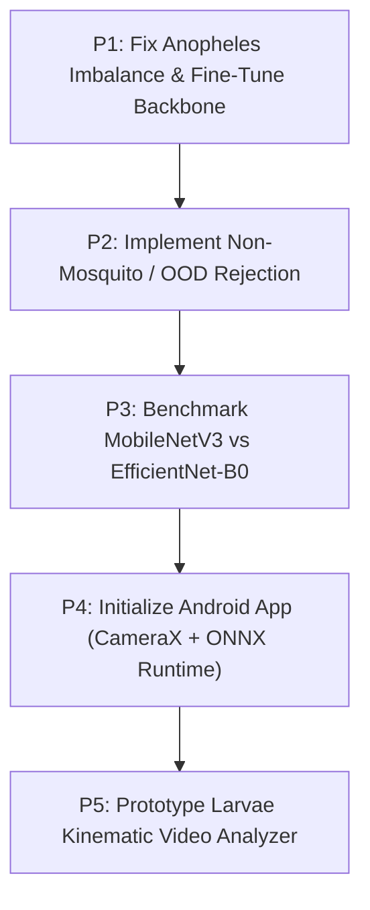

# Vectora AI — Recommended Next Steps & Roadmap

**Date:** 2026-11-11  
**Author:** Senior Machine Learning & Computer Vision Engineer (Antigravity)  

---

## Priority Action Matrix

---

### Phase 1: Model Optimization & Anopheles Recovery (Priority: P1)

**Problem:** *Anopheles* recall is currently only 11.1% on original photos and 20.6% on augmented images because only 7 training specimens were available and the convolutional feature extractor was kept frozen.

1. **Unfreeze Higher Convolutional Blocks (Stage 2 Fine-Tuning):**
   * Keep initial stages 0–4 frozen.
   * Unfreeze stages 5–7 and the classification head with a differential learning rate (`1e-4` for backbone, `1e-3` for head).
2. **Apply Class-Weighted Loss:**
   * Compute inverse-frequency weights:
     $$w_c = \frac{N}{N_c}$$
   * Pass weights to `nn.CrossEntropyLoss(weight=class_weights)`.
3. **On-the-Fly Dynamic Data Augmentation:**
   * Enhance `build_transforms(train=True)` with random resized crops (scale 0.8–1.0), subtle Gaussian blur, and perspective warps.

---

### Phase 2: Negative Rejection & Calibration (Priority: P2)

**Problem:** Softmax outputs currently lack rejection capability for non-mosquitoes or blurred images.

1. **Add Negative Class Ingestion:**
   * Populate `data/raw/non_mosquito/` with non-target arthropods (midges, craneflies, spiders, houseflies).
   * Update classification head to 4 classes (`aedes`, `anopheles`, `culex`, `non_mosquito`).
2. **Calibrated Confidence Thresholding:**
   * Implement temperature scaling or Platt scaling to calibrate raw logit outputs.
   * Require maximum predicted probability $\ge 0.65$ before presenting an identification; otherwise fall back to `Inconclusive / Retake Photo`.

---

### Phase 3: Mobile Architecture Benchmarking (Priority: P3)

**Objective:** Compare EfficientNet-B0 against ultra-lightweight mobile backbones.

1. **Implement MobileNetV3-Small & MobileNetV3-Large:**
   * Create `src/vectora/model_mobilenet.py`.
   * Compare ONNX file size, CPU latency, and macro-F1 against EfficientNet-B0.
2. **INT8 Quantization Accuracy Benchmark:**
   * Evaluate whether INT8 dynamic quantization degrades macro-F1 by more than 1% compared to FP32.

---

### Phase 4: Android Application Scaffold (Priority: P4)

**Objective:** Implement the offline-first Android client using CameraX and ONNX Runtime Mobile.

1. **Scaffold Android Project:**
   * Language: Kotlin
   * UI: Jetpack Compose
   * Build: Gradle (Kotlin DSL)
2. **Integrate CameraX:**
   * Implement viewfinder with tap-to-focus and square specimen framing overlay.
   * Add sharpness/blur detection filter before inference.
3. **Integrate ONNX Runtime Mobile:**
   * Package `models/efficientnet_b0_int8.onnx` into `app/src/main/assets/`.
   * Execute inference off the main thread using Kotlin Coroutines (`Dispatchers.Default`).

---

### Phase 5: Larvae Kinematic Pipeline Exploration (Priority: P5)

**Objective:** Address the second core pipeline from the PRD.

1. **Video Ingestion & Frame Extraction:**
   * Implement OpenCV video frame extractor (sampling at 5–10 FPS).
2. **Meniscus Detection & Body Orientation:**
   * Detect liquid surface line via Hough transform.
   * Calculate larva body axis angle relative to water meniscus (*Culex* hangs at an angle with breathing siphon; *Anopheles* lies horizontal/parallel).
